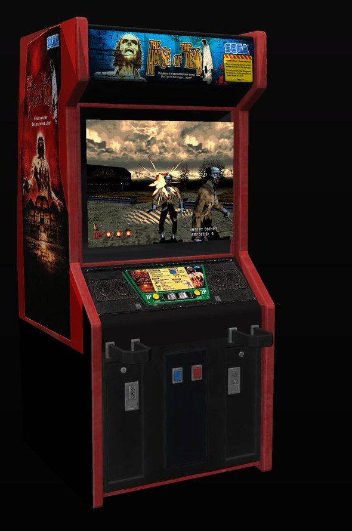
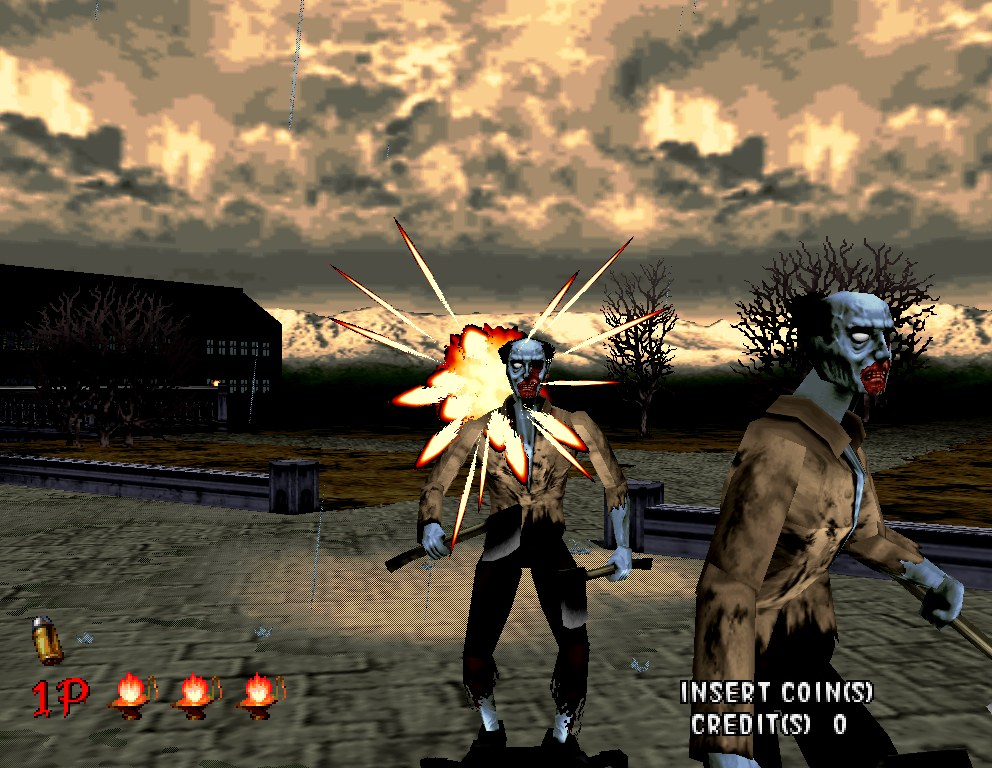
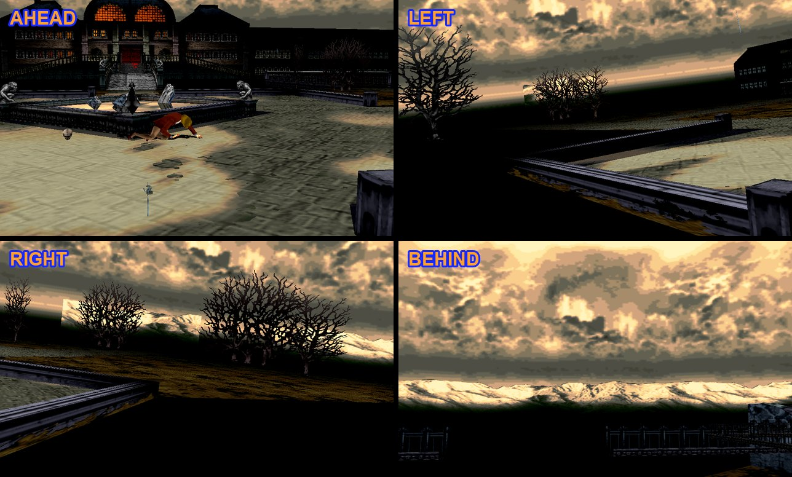
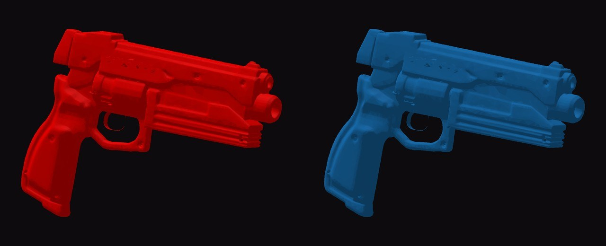

# The House of the Dead VR

**Sega's 1996 arcade original, running natively on a standalone Meta Quest 3.** You stand inside its world in full
stereo 3D with a light gun in your hand, and a friend can join you online with voice chat.

This isn't an emulator. The arcade board's programs were **statically recompiled** ahead of time into native ARM64 code
for the headset, and the board's graphics and sound hardware were rebuilt in C++ and GPU shaders. The game logic, the
enemies and the rail camera are the arcade's own code, running at the arcade's exact 57.52 frames a second.

**This repository contains no game code or data, and neither does the app.** You load your own MAME ROM set of the
arcade game (`hotd`, Revision A) in the headset the first time the app starts.

  
  

## Features

- **Inside the arcade's world.** The arcade's own polygons, textures and colour tables, rebuilt in 3D around you at
  real scale, with your head tracked on top of the rail camera's moves. The game only sends what its screen shows,
  so a hook in its scenery code makes it send the whole area: turn round and the mansion is still there.
- **Light guns.** The cabinet's own gun model, red for player 1 and blue for player 2, or a pistol with a moving
  slide. Recoil, rumble and muzzle flash, and shots go where the barrel points.
- **Physical reloads.** Drop the magazine, push in a new one, rack the slide. The game's "shoot outside the screen"
  prompt is replaced with step-by-step instructions while you do it. Classic off-screen reloading is one setting away.
- **Cabinet mode.** Play on a full arcade cabinet with restored, high-resolution marquee, control panel and side art.
  Grab it with both hands to move, turn or resize it. Put it in a dark room, in your own room (passthrough), or in the
  mansion's courtyard, captured from the game itself on your headset.
- **Online co-op with voice.** Two players over the internet (room codes, quick match) or on your own network with no
  server. A partner can join a game already under way. Voice chat has echo cancellation, noise suppression and push
  to talk.
- **Made for the headset.** In-VR menus for the guns, hands, view, comfort, graphics and sound. Settings are saved.

Standing by the fountain: what the game sends now, all round you. On the arcade's screen only the
view ahead existed.

## How it works

| Part of the arcade board | Here |
|---|---|
| Intel i960 main CPU (the game) | The program is statically recompiled to C++ |
| Motorola 68000 sound CPU and the SCSP's DSP | Recompiled; the SCSP sound chip reimplemented |
| Fujitsu MB86235 (TGPx4) geometry DSP | An interpreter derived from MAME's |
| Geometrizer, rasterizer, tilemaps | Reimplemented in C++; the rasterizer's texturing and colour rules as an OpenGL ES 3.0 shader that draws in 3D |
| The cabinet | A native OpenXR app: guns, hands, menus, passthrough, the cabinet room |
| Two cabinets linked | Deterministic lockstep: the host sends each frame's inputs, and both run the same frame, checked against a checksum of the game's memory |

MAME, the reference arcade emulator, is used only to check that the results match the real board.

The recompiler and the Model 2 runtime come from [RetroValou's Sega Model 2 recompiler](https://github.com/RetroValou/Sega-Model2-recomp-PSVita),
built on [alphanu1's Daytona USA arcade recomp](https://github.com/alphanu1/daytona-arcade-recomp) (BSD-3-Clause). This
project brought The House of the Dead's Model 2C board up on it, then built the VR, the 3D output and online play
on top.

What was found in the game to make VR work, with addresses, is in [docs/vr.md](docs/vr.md):
- the scenery visibility test;
- where lives, bullets and game state live in memory, so reloads count only in play;
- the operator settings;
- the light-gun wiring;
- the reload prompt;
- the shape of the 3D output.

## Playing it

You need a **Meta Quest 3**. The Quest 3S has the same processor and should work, but it hasn't been tested.

1. Install the APK (from this repository's releases) with SideQuest or `adb install`.
2. Copy your ROM set to the headset, for example into Download. It must be MAME's `hotd.zip` or `hotd.7z`,
   Revision A.
3. Start **HOTD Arcade VR** from Unknown Sources. Pull the trigger and choose the ROM set. The app checks it, keeps its
   own copy and offers to delete the one you copied.

The left menu button opens the VR menu, and a thumbstick click switches between standing in the game and the cabinet.
Online play is on the menu's ONLINE tab.

## Building from source

On Windows:

1. Run `setup.ps1`. It installs the build tools and fetches the pinned dependencies into `extern/`.
2. Put your ROM set at `roms/hotd.zip` or `roms/hotd.7z`, then run `python scripts/recompile.py --game houseofthedead`.
   This generates the recompiled code and the desktop tools under `build_houseofthedead/`. Everything there is
   derived from your ROM set and ignored by git.
3. Install the Android SDK with an NDK, build-tools, a platform, platform-tools, and Java 17 or later.
4. Run `python scripts/build_quest.py`. It fetches the OpenXR loader, the SDL2 headers and the voice libraries into
   `third_party/quest`, then builds, installs and starts the APK on a headset connected over USB. Use `--apk-only`
   to only build it.

| | |
|---|---|
| `src/runtime`, `src/games` | The Model 2 runtime, and The House of the Dead's game definition and hooks |
| `src/quest` | The Quest app, plus the bridge to the game (`arcade_quest.cpp`) and its 3D renderer (`m2_gl.c`) |
| `src/net` | Online play: the lobby and relay client, the local-network host, rooms |
| `tools` | The recompilers, desktop test tools (`m2gpushot`, `m2probe`, `m2nettest`, `m2netguest`), the cabinet and gun model pipelines, the crash-report relay |
| `docs` | [vr.md](docs/vr.md) (the VR version), the recompiler's design notes, the cabinet art sources |

## Credits and licences

The project's code is BSD-3-Clause ([LICENSE](LICENSE)). The components it uses keep their own licences, listed in
[THIRD_PARTY.md](THIRD_PARTY.md):
- the Model 2 recompiler and runtime (BSD-3-Clause);
- code transplanted from MAME (BSD-3-Clause);
- the online lobby client from namco22-decompile (MIT);
- the Khronos OpenXR loader (Apache-2.0);
- SDL2's headers (zlib);
- Opus, SpeexDSP and RNNoise (BSD);
- the menu font (SIL OFL);
- the arcade cabinet model by Seraphim Sarov (CC BY 4.0);
- the hands by Askasknot (CC BY 4.0);
- the pistol (CC0).

The House of the Dead, its artwork and SEGA are trademarks or copyrights of SEGA. This is an independent fan
project, not affiliated with or endorsed by SEGA. The cabinet artwork is SEGA's; the restored versions here are for
this fan project only.
