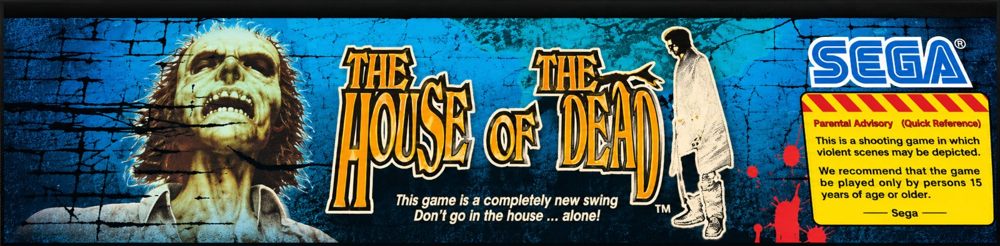
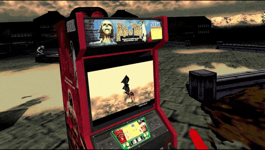
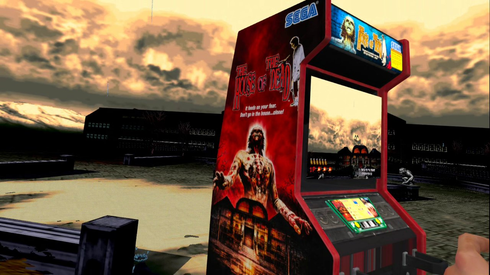
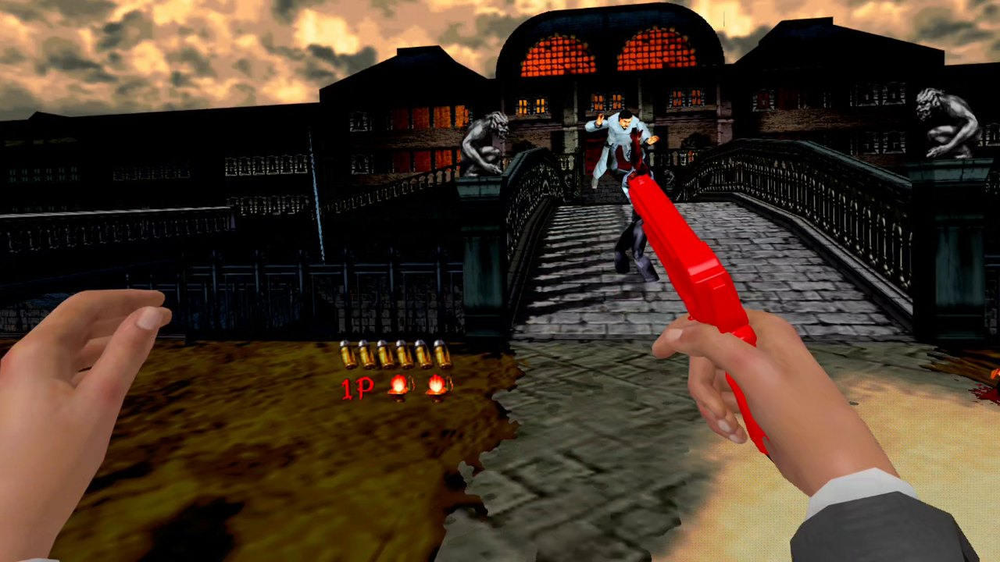
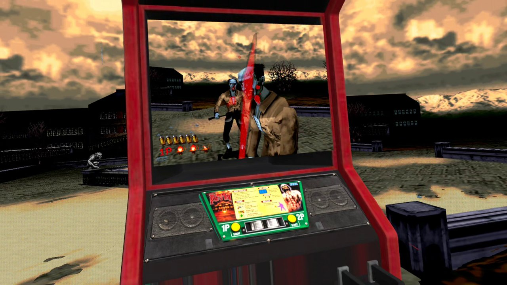
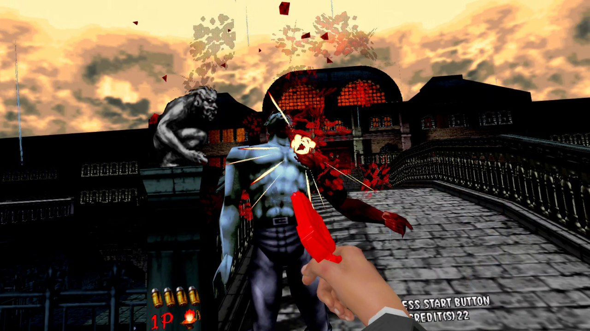
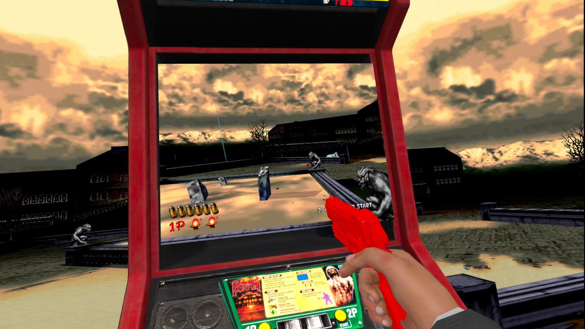
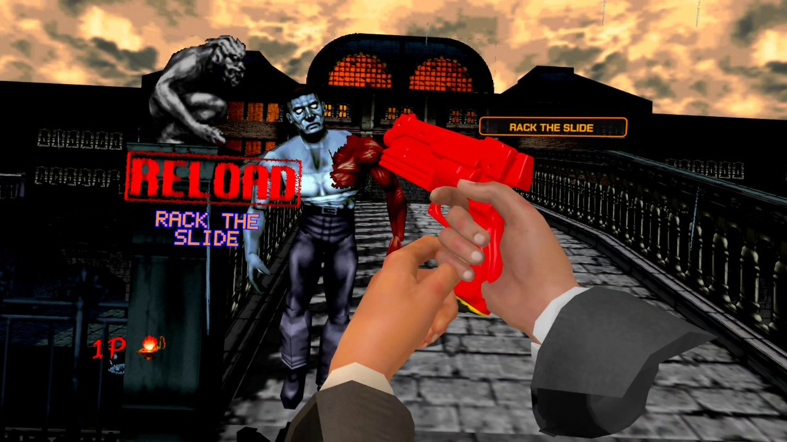

<a href="https://www.youtube.com/watch?v=qA4V-auLHN0"><b>&#9654; Watch the gameplay video on YouTube</b></a>

# The House of the Dead VR

**Sega's 1996 arcade original, running natively on a standalone Meta Quest 3.** You stand inside its world in full
stereo 3D with a light gun in your hand, and a friend can join you online with voice chat. The same game also plays
flat on **Windows, the Mac, Android phones and tablets, and iPhone and iPad**, and every version plays online with
every other.

This isn't an emulator. The arcade board's programs were **statically recompiled** ahead of time into native code
(ARM64 for the headset, phones and Macs, x64 for Windows), and the board's graphics and sound hardware were rebuilt
in C++ and GPU shaders. The game logic, the enemies and the rail camera are the arcade's own code, running at the
arcade's exact 57.52 frames a second.

**This repository contains no game code or data.** You load your own MAME ROM set of the
arcade game (`hotd`, Revision A) the first time the app starts.

<table>
  <tr><th>Cabinet view</th><th>Immersive view</th></tr>
  <tr>
    <td></td>
    <td></td>
  </tr>
  <tr>
    <td></td>
    <td></td>
  </tr>
  <tr>
    <td></td>
    <td></td>
  </tr>
</table>

Captured on a Quest 3. Hold the gun hand's thumbstick click to switch between the cabinet and standing in the game.

## Features

- **Inside the arcade's world.** The arcade's own polygons, textures and colour tables, rebuilt in 3D around you at
  real scale, with your head tracked on top of the rail camera's moves. The game only sends what its screen shows,
  so a hook in its scenery code makes it send the whole area: turn round and the mansion is still there.
- **Light guns.** The cabinet's own gun model, red for player 1 and blue for player 2, or a pistol with a moving
  slide. Recoil, rumble and muzzle flash, and shots go where the barrel points.
- **Physical reloads.** Drop the magazine, push in a new one, rack the slide. The game's "shoot outside the screen"
  prompt is replaced with step-by-step instructions while you do it. Classic off-screen reloading is one setting away.
- **Cabinet mode.** Play on a full arcade cabinet with restored, high-resolution marquee, control panel and side art.
  Grab it with both hands to move, turn or resize it. Put it in a dark room, in your own room (passthrough), or in the
  mansion's courtyard, captured from the game itself on your headset.
- **Online co-op with voice, across platforms.** Two players over the internet (room codes, quick match) or on your
  own network with no server. A Quest player and a PC, Mac, phone or iPad player share the same game, frame for frame.
  A partner can join a game already under way. Voice chat has echo cancellation, noise suppression and push to talk.
- **Made for the headset.** In-VR menus for the guns, hands, view, comfort, graphics and sound. Settings are saved.
- **Flat on every screen.** On a PC, Mac, phone or tablet the game fills the window at its 4:3 shape, drawn in HD at
  the window's resolution or as the arcade's original 496 x 384 picture. Aim with the mouse, a light gun that acts
  as a mouse (Sinden, GunCon 3, Gun4IR), a game pad (its gyroscope too), a touch screen or the phone's gyroscope.
- **Updates in the app.** The Quest, Steam Frame and Android apps look for a new release when they start and install
  it from the menu.

## How it works

| Part of the arcade board | Here |
|---|---|
| Intel i960 main CPU (the game) | The program is statically recompiled to C++ |
| Motorola 68000 sound CPU and the SCSP's DSP | Recompiled; the SCSP sound chip reimplemented |
| Fujitsu MB86235 (TGPx4) geometry DSP | An interpreter derived from MAME's |
| Geometrizer, rasterizer, tilemaps | Reimplemented in C++; the rasterizer's texturing and colour rules as an OpenGL ES 3.0 shader that draws in 3D |
| The cabinet | On the headsets, a native OpenXR app: guns, hands, menus, passthrough, the cabinet room. On screens, a flat app per OS (Win32, AppKit, UIKit, Android) round the same game and menu |
| Two cabinets linked | Deterministic lockstep: the host sends each frame's inputs, and both run the same frame, checked against a checksum of the game's memory. Every compiler builds it with strict floating point, so an x64 PC and an ARM64 headset compute the same game bit for bit |

The renderer is one OpenGL ES 3.0 code path everywhere: native on the Quest and Android, desktop GL 3.3 on Windows,
and ANGLE on Metal on the Mac, iPhone and iPad.

MAME, the reference arcade emulator, is used only to check that the results match the real board.

The recompiler and the Model 2 runtime come from [RetroValou's Sega Model 2 recompiler](https://github.com/RetroValou/Sega-Model2-recomp-PSVita),
built on [alphanu1's Daytona USA arcade recomp](https://github.com/alphanu1/daytona-arcade-recomp) (BSD-3-Clause). This
project brought The House of the Dead's Model 2C board up on it, then built the VR, the 3D output and online play
on top.

What was found in the game to make VR work, with addresses, is in [docs/vr.md](docs/vr.md):
- the scenery visibility test;
- where lives, bullets and game state live in memory, so reloads count only in play;
- the operator settings;
- the light-gun wiring;
- the reload prompt;
- the shape of the 3D output.

## Playing it

Every download is on this repository's [releases](https://github.com/MrSco/house-of-the-dead-vr/releases), built
from the same code; each release's notes say how to install each one. None contains any of the game: you bring your
own MAME ROM set, `hotd.zip` or `hotd.7z`, Revision A.

| Platform | Download | Status |
|---|---|---|
| **Meta Quest 3** (and 3S) | `house-of-the-dead-vr-<version>.apk` | The main version, tested on a Quest 3. The 3S has the same processor but hasn't been tested |
| **Windows PC** | `house-of-the-dead-vr-<version>-windows-x64.zip` | Flat: mouse, pads, light guns |
| **Mac** (Apple silicon) | `house-of-the-dead-vr-<version>-mac.zip` | Flat; experimental |
| **Android phones and tablets** (64-bit, Android 10+) | `house-of-the-dead-vr-<version>-android.apk` | Flat: touch, gyro, pads; experimental, tested in an emulator |
| **iPhone and iPad** | `house-of-the-dead-vr-<version>-ios.ipa` (SideStore), or TestFlight if invited | Flat; experimental, tested in the simulator |
| **Steam Frame** | `house-of-the-dead-vr-<version>-frame.apk` | The Quest app for Valve's headset; experimental, not yet run on a Frame |

**On the Quest:**

1. Install the APK with SideQuest or `adb install`.
2. Copy your ROM set to the headset, for example into Download.
3. Start **House of the Dead VR** from Unknown Sources. Pull the trigger and choose the ROM set. The app checks it, keeps its
   own copy and offers to delete the one you copied.

**On Windows:** unzip anywhere and run `HOTDVR/HOTDVR.exe`; it asks for the ROM set the first time (or put `hotd.zip`
in `HOTDVR/files/arcade` first). It isn't code-signed: if SmartScreen warns, choose **More info**, then **Run anyway**.

**On the Mac:** unzip, move **House of the Dead VR** to Applications and open it. It isn't notarized: the first time,
open **System Settings > Privacy & Security** and choose **Open Anyway**.

**On a phone, iPhone or iPad:** install the APK, or the IPA with SideStore (which signs it with your Apple ID), and
choose the ROM set when the app asks for it.

Online play is on the menu's ONLINE tab, and any platform can join any other. The VR menu's CONTROLS button lists
every control, as your settings make them.

**Updates:** the Quest, Steam Frame and Android apps look for one when they start, and the menu's SYSTEM tab shows it
(UPDATE TO ...). It downloads the new APK, checks it and hands it to the installer; your ROM set, settings and saves
are kept. TEST BUILDS on that tab offers pre-release test builds too. The first update asks you to let the app
"Install unknown apps". On Windows and the Mac, unzip the new release over the old one (the `files` folder is kept).

### Controls in VR

The gun is in your right hand unless the HANDS tab says otherwise; "other hand" is the one without it.

| Controllers | |
|---|---|
| Trigger | Shoot. Off the screen: reload (the cabinet view, or Reload gesture OFF) |
| Reload (Reload gesture MAGAZINE, the default) | Other hand's grip takes a magazine: push it into the gun's grip, then pull the slide |
| Reload (POINT DOWN / OFF) | Aim at the floor / shoot off the screen, B or Y, or a firm grip squeeze |
| B / Y | Drop the magazine (MAGAZINE); reload (Reload gesture OFF) |
| A / X | Coins and Start; skip a scene |
| Left menu button | The VR menu (the game pauses, except online) |
| Gun hand's thumbstick click, held | Switch between standing in the game and the cabinet |
| Other hand's thumbstick click | Online, PUSH TO TALK: talk while held |
| Other hand's grip, at the gun | Hold the gun in both hands |
| Both grips, hands apart | The cabinet view: move, turn and size the cabinet |

| Your hands (no controllers) | |
|---|---|
| Point | Aim |
| Index finger pinch | Shoot. Off the screen: reload |
| Other hand's middle finger pinch | Coins and Start; skip a scene |
| Left palm toward you, pinch | The VR menu |

In the menu: the trigger (or a pinch) chooses what the laser points at, the sticks move, A / X choose, B / Y go back and
the grips switch tabs.

### Controls on a screen

| | Mouse and keyboard (Windows, Mac) | Game pad | Touch (phones, tablets) |
|---|---|---|---|
| Aim | The pointer (or a light gun that acts as a mouse) | Either stick moves a sight; pad gyro aim in GAME | Where you tap; gyro aim in GAME |
| Shoot | Left button | Right trigger or R1 | Tap the picture |
| Reload | Right button, or shoot off the picture | Left trigger, L1 or X / Square | A second finger, or RELOAD |
| Coins and Start; skip a scene | Space or Enter | A / Cross or Start | START |
| Menu | Esc | Back / Select / Share | MENU, or Android's Back |
| Push to talk (online) | T, held | | |
| Full screen | F11 or Alt+Enter (Windows); F11 or Ctrl+Cmd+F (Mac) | | |

In the menu: the arrow keys or the stick move, Enter or A choose, Esc or B go back, Tab or the bumpers switch tabs;
the mouse and touch point at it.

## Building from source

The PC recompiles the game and builds the Quest, Android and Windows apps; the Apple apps are built on a Mac from the
PC's checkout. [docs/getting-started.md](docs/getting-started.md) goes through it step by step.

1. On Windows, run `setup.ps1`. It installs the build tools and fetches the pinned dependencies into `extern/`.
2. Put your ROM set at `roms/hotd.zip` or `roms/hotd.7z`, then run `python scripts/recompile.py --game houseofthedead`.
   This generates the recompiled code and the desktop tools under `build_houseofthedead/`. Everything there is
   derived from your ROM set and ignored by git.
3. Build the platform you want:

| Platform | Command | Needs |
|---|---|---|
| Quest | `python scripts/build_quest.py` (builds, installs and starts it over USB; `--apk-only` only builds) | The Android SDK with an NDK, build-tools, a platform and platform-tools; Java 17 or later. The script fetches the OpenXR loader, SDL2's headers and the voice libraries into `third_party/quest` |
| Steam Frame, Android phones | `python scripts/build_quest.py --flavor frame` or `--flavor phone` | As the Quest |
| Windows | `python scripts/build_windows.py [--run] [--zip]` (`build_windows/HOTDVR.exe`) | Visual Studio with the C++ tools (MSVC); the script uses its CMake and Ninja |
| iPhone, iPad, Mac | `python scripts/apple_sync.py` on the PC, then `python3 scripts/build_apple.py simulator`, `device` or `mac` on the Mac (`--app`, `--ipa`) | Xcode, xcodegen, and ANGLE built in `~/angle` |

`python scripts/release.py` builds every platform's download from one commit for a release, and
`python scripts/crossplay_check.py` checks that the PC and the Quest compute the same game, bit for bit (run it after
any compiler, flag or runtime change).

| | |
|---|---|
| `src/runtime`, `src/games` | The Model 2 runtime, and The House of the Dead's game definition and hooks |
| `src/core` | What every app shares: the bridge to the game (`arcade.cpp`), online play's lockstep, the 3D renderer (`m2_gl.c`), the menu, voice chat |
| `src/quest` | The VR app for the Quest and the Steam Frame: OpenXR, the guns and hands, the cabinet room, the Android activities |
| `src/flat` | The flat app for screens, with a front end per OS: `win`, `mac`, `ios`, `android` |
| `src/platform` | The OS seam (`platform.h`): files, threads, sound, the microphone, GL; its Android, Windows and Apple bodies |
| `src/net` | Online play: the lobby and relay client, the local-network host, rooms |
| `tools` | The recompilers, desktop test tools (`m2gpushot`, `m2probe`, `m2nettest`, `m2netguest`, `m2statetest`), the cabinet and gun model pipelines, the crash-report relay |
| `docs` | [vr.md](docs/vr.md) (the VR version), [platforms.md](docs/platforms.md) (the other platforms and crossplay), the [release notes](docs/releases), the recompiler's design notes, the cabinet art sources |

## Credits and licences

The project's code is BSD-3-Clause ([LICENSE](LICENSE)). The components it uses keep their own licences, listed in
[THIRD_PARTY.md](THIRD_PARTY.md):
- the Model 2 recompiler and runtime (BSD-3-Clause);
- code transplanted from MAME (BSD-3-Clause);
- the online lobby client from namco22-decompile (MIT);
- the Khronos OpenXR loader (Apache-2.0);
- SDL2's headers (zlib);
- Opus, SpeexDSP and RNNoise (BSD);
- the menu font (SIL OFL);
- the arcade cabinet model by Seraphim Sarov (CC BY 4.0);
- the hands by Askasknot (CC BY 4.0);
- the pistol (CC0).

The House of the Dead, its artwork and SEGA are trademarks or copyrights of SEGA. This is an independent fan
project, not affiliated with or endorsed by SEGA. The cabinet artwork is SEGA's; the restored versions here are for
this fan project only.

What the apps keep and send (online play, voice chat, crash reports, the update check) is in [PRIVACY.md](PRIVACY.md).
